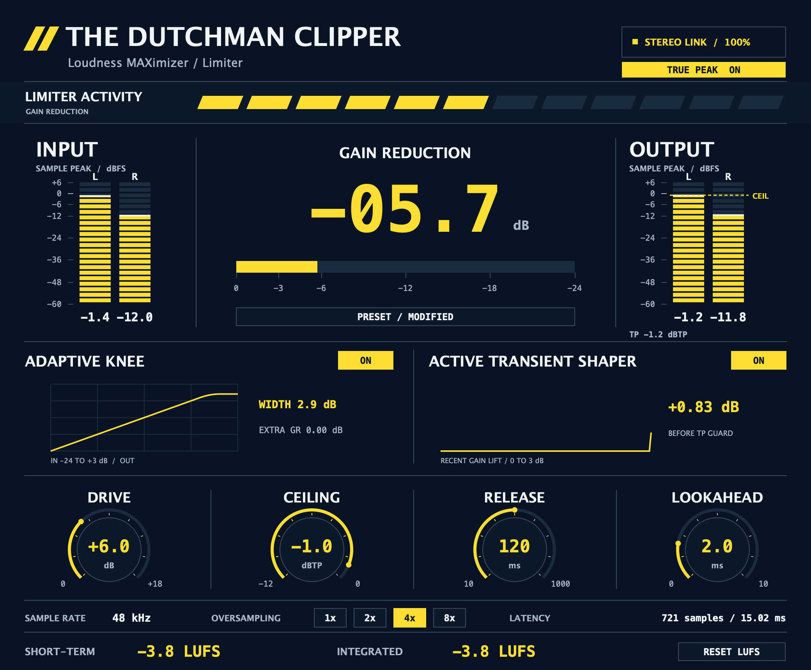

# The Dutchman Clipper

**Loudness MAXimizer / Limiter — v1.0.0**

ステレオのマスター最終段に使うLimiter／Maximizer。Driveで処理量を調整し、Ceilingで出力上限を管理します。

## ダウンロード

[Releases](https://github.com/fenrirlone9395/The-Dutchman-Clipper/releases)から配布ZIPを取得してください。macOS 14以降、Apple Silicon向けのVST3／AU／Standaloneを同梱しています。Intel Mac・Windowsは対象外です。

## インストール

ホストを終了してから、ZIP内の各形式を次の場所へ配置してください。

| 形式 | 配置先 |
| --- | --- |
| VST3 | `~/Library/Audio/Plug-Ins/VST3/` |
| AU | `~/Library/Audio/Plug-Ins/Components/` |
| Standalone | `Applications`フォルダーなど任意の場所 |

ホストを再起動し、プラグインを再スキャンしてください。ローカル用アドホック署名のみで、Developer ID署名・Apple公証は行っていません。macOSのセキュリティ確認が表示される場合があります。

## 操作

- **Drive：0〜+18 dB**。初期値0 dB。前段でレベルを整えた2mixを押し込みます。
- **Ceiling：−12〜0 dB**。TP ONではdBTP、OFFではdBFS。初期値−1 dB。
- **Release：10〜1000 ms**。主Limiterの回復速度。
- **Lookahead：0〜10 ms**。主Limiterの先行減衰範囲。
- 4つのノブはドラッグ、マウスホイール、ダブルクリックによる初期値復帰に対応。
- **Oversampling：×1／×2／×4／×8**。初期値×4。
- **True Peak：ON／OFF**。初期値ON。処理倍率と独立した検出で、×1でもTPを保護します。
- **Adaptive Knee／Active Transient Shaper**。初期値OFF。可変ニーとアタックの減衰形状を調整し、介入量を表示します。Shaper表示はTP保護より前の値です。
- Input／Outputの左右Peak、GR、最終出力TP、Short-Term／Integrated LUFSを表示。上部LEDはGRを表示します。
- PRESETボタンでINITIAL／MASTER CLEAN／TRANSIENT／STREAM SAFEを切り替え。RESET LUFSで測定を初期化します。

Stereo Linkは常時100%。ディザは内蔵していません。必要に応じてDAWの最終書き出し側で適用してください。StandaloneはOptionsで入出力を設定し、回り込みのない経路で入力ミュートを解除してください。

## 出力と互換性

TP保護には**0.15 dBの安全余裕**があります。Ceiling −1 dBTPでは内部目標が−1.15 dBTPになります。48 kHzでのホスト報告遅延は**721サンプル（約15.02 ms）**。倍率・Lookahead・TPのON/OFFによって報告遅延は変わりません。ホストバイパスも遅延を合わせますが、バイパスとその移行中のドライ信号はCeiling保護の対象外です。TP ONへの移行には20 msかかります。

旧版の負のDrive値は0 dBに変換します。正規化値で記録された旧Driveオートメーションは範囲変更により再確認が必要です。アプリ終了後の設定保持にはホスト側の保存・復元が必要です。

## 検証と制限

macOS Sonoma／Apple Siliconで3形式をビルド。VST3／AUの実バンドル処理、Standalone起動、pluginvalレベル10、ホイール操作、状態復元の回帰試験を確認しています。独立計器libebur128によるTP試験は44.1／48／96 kHz・4倍率・float32／float64で実施し、最終出力がCeiling +0.1 dB以内を合格条件としました。LUFSも独立計器と比較しています。

5分相当の連続処理はオフライン試験です。全DAWでの遅延補償、AUのシステムスキャンとauval、Steinberg標準Validator、実デバイス入出力での長時間稼働は網羅していません。

## ライセンス

無償の独自ライセンスによるバイナリ配布です。個人・商用の音楽制作に利用できます。オープンソース製品ではなく、このリポジトリには製品ソースを含みません。詳細は[LICENSE.txt](LICENSE.txt)と[第三者ライセンス表記](THIRD_PARTY_NOTICES.md)を参照してください。
